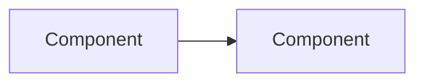

# Proposal title

<!--
Copy this file (the scaffold-design skill does this for you) to
designs/shared/ or designs/<github-repo-name>/ as 0000-short-slug.md, or to
0000-short-slug/README.md for the multi-file format. Before merge, rename
0000 to the pull-request number and update the two in lockstep: the file name
and the "id" in the frontmatter. Keep the H1 heading in sync with "title".
See designs/AGENTS.md for the rules.
-->

## Summary

One paragraph: what is proposed, which projects it affects, and the outcome
it produces.

## Motivation & Problem Space

What problem this solves, for whom, and why now. Cite issues, incidents, user
feedback or upstream discussions (put their IDs in the `tracking` frontmatter).

## Goals

- Specific, verifiable goals.

## Non-Goals

- Explicitly out of scope — real exclusions a reviewer might otherwise expect,
  not strawmen.

## Proposal & Design Details

The design itself. For cross-project proposals, enumerate the blast radius per
project and spell out API/schema contracts (CRD fields, conditions,
annotations) precisely enough to implement against. Inline Mermaid diagrams
render on GitHub:

Multi-file proposals (assets, review notes, implementation plans) use the
folder format `NNNN-short-slug/README.md`; reference the supporting files from
this section.

## Risks, Security & Mitigations

What can go wrong, how bad it is, and what contains it. medik8s operators
reboot hosts and fence nodes — reason about privilege boundaries, forgeable
inputs, and failure modes that surface as reboots or split-brain rather than
as failed tests.

## Alternatives Considered

- **[Alternative]:** summary of the approach, its real trade-offs, and why it
  was not chosen.

## Test Plan

Unit, `envtest`, e2e and CI coverage this design requires before it can be
marked `implemented`. Docs-only or process proposals may mark this `N/A`.

## Rollout, Migration & Graduation Criteria

How the change ships (feature gates, defaults, OLM upgrade path), how to roll
it back, and the objective criteria for moving the status to `implemented`.

<!-- The sections below are optional. Delete the ones that do not apply. -->

## Upgrade / Downgrade Concerns

Version-skew behavior, CRD schema and conversion-webhook impacts, and what
happens to in-flight remediations or fenced nodes during an operator upgrade
or rollback.

## Open Questions

- **[Question]:** what would settle it, and who owns the answer.

## Terminology

Terms used in this document, expanded on first use (SBR, SNR, NHC, FAR, MDR,
CSI, RWO, RWX, …).
