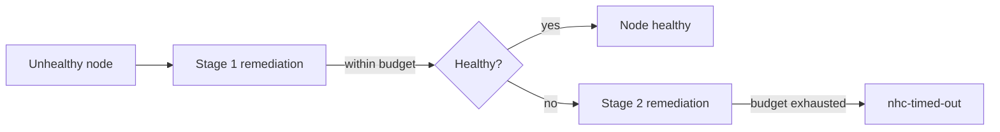

# Escalation timeout budget across remediation stages

> **Worked example.** This document demonstrates the single-file format with
> an inline Mermaid diagram. It is not a decision. Real proposals take their
> `id` from their pull-request number.

## Summary

Give `NodeHealthCheck` an explicit, per-remediation timeout budget that spans
the whole escalation chain, instead of each stage restarting the clock.

## Motivation & Problem Space

Today every remediation stage gets its own timeout, so the total wall-clock
time of an escalation is unbounded in practice: a policy with three stages
can hold an unhealthy node for the sum of all stage timeouts, while operators
reason about each timeout as if it were the total.

## Goals

- A single, documented budget covering the full escalation of one unhealthy
  node.

## Non-Goals

- Changing the default stage timeouts.
- Enforcing budgets across NHC restarts (recomputed after a restart).

## Proposal & Design Details

Add `remediationTimeoutBudget` to the `NodeHealthCheck` spec. The controller
starts the budget when the node first matches the unhealthy conditions and
annotates `nhc-timed-out` when the budget expires, independent of the stage
that is currently in flight.

## Risks, Security & Mitigations

A budget shorter than one stage's own timeout makes that stage pointless;
Mitigation: webhook validation rejects budgets below the highest configured
stage timeout.

## Alternatives Considered

- **Divide the budget evenly across stages** — a slow first stage starves the
  last, which is usually the most destructive (and most effective) one.
- **Keep per-stage timeouts and document the sum** — documentation does not
  bound anything at runtime.

## Rollout, Migration & Graduation Criteria

Feature is additive and defaults to unset (current behavior). Graduation to
`implemented` requires e2e coverage where the budget expires mid-stage and
the node is timed out.

## Test Plan

Unit tests for budget arithmetic across stage transitions; e2e test with a
two-stage policy and a deliberately small budget.
