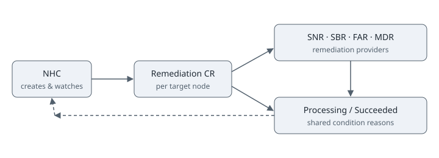

# Standardized remediation progress conditions

> **Worked example.** This proposal exists to demonstrate the multi-file
> folder format (`README.md` plus assets). It is not a decision. Real
> proposals take their `id` from their pull-request number.

## Summary

Every remediation provider (SNR, SBR, FAR, MDR) reports progress on its
remediation CR today, but with provider-specific conditions and timings. This
proposal defines a shared set of conditions — `Processing` and `Succeeded`,
with a common reason vocabulary — so NHC can escalate on facts instead of
per-provider heuristics.

## Motivation & Problem Space

NHC escalates through remediation providers in order. To decide when a stage
has finished (or has no chance of finishing) it currently interprets each
provider's status shape separately, and the `nhc-timed-out` annotation is the
only common signal. Adding a provider today means teaching NHC a new dialect.

## Goals

- One condition vocabulary across all remediation providers.
- NHC escalation decisions based on provider-reported state, not only
  timeouts.

## Non-Goals

- Changing when NHC *starts* a remediation — only how it observes progress.
- A new CRD or a shared controller; this is a contract, not a component.

## Proposal & Design Details

Each provider sets `Processing` while the remediation is in flight and
`Succeeded` once the host is confirmed remediated (rebooted, fenced, or
deleted), with shared reasons (`NodeRebooted`, `FenceSucceeded`,
`NodeDeleted`, `TimedOut`). NHC watches the conditions instead of
re-deriving progress. Migration is per provider; see the rollout section.

Supporting files (concern lists, implementation plans, review notes) may live
next to this `README.md` inside the proposal folder; the frontmatter stays on
`README.md`.

## Risks, Security & Mitigations

Conditions are set by controllers with cluster-wide write access; a
compromised provider could report `Succeeded` early and suppress escalation.
Mitigation: NHC keeps the `nhc-timed-out` annotation as an independent
deadline that no provider can clear.

## Alternatives Considered

- **Per-provider adapters in NHC** — the status quo; every provider change
  requires an NHC release.
- **Events instead of conditions** — events are best-effort and not
  watchable reliably for escalation decisions.

## Rollout, Migration & Graduation Criteria

One provider per release, SBR first (it already reports a storage health
condition). Rollback is per provider: stop setting the new conditions; NHC
falls back to the timeout annotation. Status moves to `implemented` when all
four providers report the conditions and NHC escalates on them in e2e tests.

## Open Questions

- Do CUR and WAO consume the same conditions, and does that change the
  reason vocabulary?
